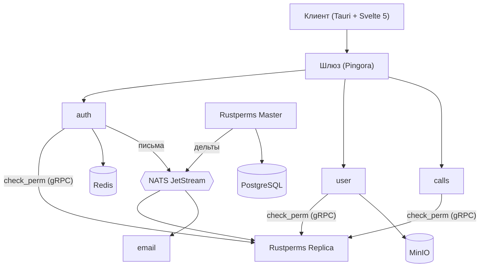

# Vesper

Платформа на микросервисах: аккаунты и профили, OAuth, голосовые звонки
(WebRTC-сигналинг) и собственная распределённая система прав **Rustperms**.
Бэкенд на Rust, клиент на Tauri + Svelte 5

Проект личный, делался два года как полигон для проектирования
распределённых систем и обучения языку

## Статус

| Компонент | Что делает | Статус |
|---|---|---|
| `auth` | регистрация, вход, OAuth (Google/Discord), JWT, refresh-токены | работает |
| `user` | профили, мини-профили, загрузка аватаров/фонов в MinIO | работает |
| `calls` | комнаты и WebRTC-сигналинг (WebSocket + NATS JetStream) | работает |
| `email` | отправка писем из очереди через SMTP | работает |
| `rustperms_nodes` | Master/Replica системы прав (gRPC + NATS) | работает |
| `load_balancer` | L7-шлюз на Pingora | работает |
| `init` | миграции, наполнение дефолтными группами | работает |
| `vesper_client` | десктоп-клиент (Tauri + Svelte 5) | частично |

## Архитектура



## Rustperms: система прав

Права это строки с точками: `user.profile.edit.<uuid>.bg`.
Хранятся в префиксном дереве, поддерживают подстановки:

- `?` ровно один сегмент, `*` один или больше (не более одного на правило);
- приоритет совпадения: точное > `?` > `*`;
- права пользователя и групп с весами; при равном весе запрет сильнее
  разрешения; группы наследуют друг от друга.

Маршруты и права описываются в одном месте:

```rust
router!(p,
  "/api/user/edit" : (AuthAccessLayer::only_authorized()) => {
    put "/avatar"   -> set_avatar   ("user.profile.edit.{from_access}.avatar")
    put "/nickname" -> set_nickname ("user.profile.edit.{from_access}.nickname")
  }
);
```

`{from_access}` подставляется из токена, `{guid}` из параметров пути.

**Распределённость.** Master хранит правила в PostgreSQL и рассылает
изменения через NATS; каждая реплика держит полное дерево в памяти, так что
проверки идут локально, а при падении Master права продолжают проверяться.
(Шардирование групп сейчас «виртуальное»: деление по имени внутри одного
процесса, не между узлами.)

**Производительность.** Поиск по дереву ~ 85 нс на пути из 5 сегментов,
не зависит от числа правил (проверено до 1 млн пользователей).
Бенчмарк: `cargo run --release --bin bench`
(замер на i5-12500h, windows 24h2)

## Запуск

```bash
cp .env.example .env            # заполните значения
openssl genrsa -out private.pem 2048
openssl rsa -in private.pem -pubout -out public.pem
docker compose up -d            # postgres, redis, nats, minio
cargo run -p rustperms_nodes --bin master
cargo run -p init               # миграции и дефолтные группы
cargo run -p rustperms_nodes --bin replica
cargo run -p auth & cargo run -p user & cargo run -p calls &
cargo run -p email & cargo run -p load_balancer
```

Фронтенд
```bash
git clone https://github.com/Kaiva-Morphin/vesper_client
cd vesper_client && npm install && npm run tauri dev
```

## Стек

Rust, Axum, Tonic (gRPC), Pingora, SeaORM, PostgreSQL, Redis/Dragonfly,
NATS JetStream, MinIO, JWT (RS256), Tauri v2, Svelte 5.

## Известные ограничения

- Запись в БД и публикация дельты в NATS не атомарны (нужен outbox).
- При превышении лимита сессий сбрасываются все сессии пользователя,
  проверка лимита не атомарна.
- Нет failover для Rustperms Master.
